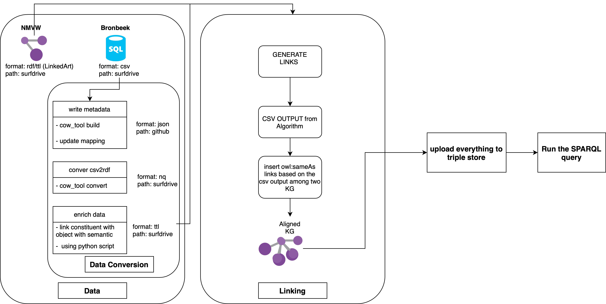

# Entity Linking across Museum Collections

This project links person records (actors) between the **Wereldmuseum** (formerly NMVW) and **Bronbeek** collections, then uses those links for knowledge discovery. It covers the full pipeline:

1. Extract the Wereldmuseum data and convert the Bronbeek data to RDF.
2. Align actors across the two datasets with five name-matching techniques.
3. Publish the matches as `owl:sameAs` links.
4. Answer competency questions over the linked data with SPARQL.

The accompanying paper is [Sarah_Supporting_KD.pdf](Sarah_Supporting_KD.pdf), with additional detail in [Supplement_Materials.pdf](Supplement_Materials.pdf).



*Pipeline to follow to recreate the query results.*

<!---[edit](https://app.diagrams.net/#G16X1PiVgtSVrZNMkEIWW3eY17JztUH5w4#%7B%22pageId%22%3A%22prtHgNgQTEPvFCAcTncT%22%7D)-->

## Contents

- [Getting started](#getting-started)
- [Repository layout](#repository-layout)
- [Data preparation](#data-preparation)
- [Entity alignment](#entity-alignment)
- [Knowledge discovery](#knowledge-discovery)

## Getting started

### Prerequisites

- [Conda](https://docs.conda.io/). The environment uses Python 3.9 and was exported on macOS, so on other platforms you may need to remove macOS-only packages such as `appnope` from [environment.yml](environment.yml).
- About 2 GB of disk space. Trained DeezyMatch models and intermediate results are committed to the repository.
- [ClioPatria](https://cliopatria.swi-prolog.org/), only if you want to load the RDF and run the SPARQL queries yourself.

### Installation

The current code is on the `serendipity` branch. The default `main` branch has an older layout that does not match this guide.

```bash
git clone --branch serendipity https://github.com/Shoilee/dh_entity_linking_v2.git
cd dh_entity_linking_v2
conda env create -f environment.yml
conda activate actor_linking
```

### Running a notebook

Experiments are Jupyter notebooks and use paths relative to their own folder, so run them with that folder as the working directory. JupyterLab does the following automatically, as does VS Code when you select the `actor_linking` kernel. JupyterLab is not part of `environment.yml`, so install it first:

```bash
pip install jupyterlab
jupyter lab entity_alignment/ground_truth/exp300.ipynb
```

### Data

The source datasets are not included in this repository, so you need your own copy to re-run the extraction, conversion and matching steps. The locations used by the project are listed in the [Bronbeek conversion notes](data_preparation/bronbeekdataConversion/README.md).

The repository does include the competency-question query results, so you can reproduce those numbers without a triple store. See [Knowledge discovery](#knowledge-discovery).

## Repository layout

| Path | Contents |
| ---- | -------- |
| [data_preparation/nmvwdatadump](data_preparation/nmvwdatadump) | Wereldmuseum extraction and filtering scripts |
| [data_preparation/bronbeekdataConversion](data_preparation/bronbeekdataConversion) | Bronbeek CSV-to-RDF conversion, mappings, enrichment and ClioPatria library definition |
| [entity_alignment](entity_alignment) | String-matching techniques and shared [utilities](entity_alignment/utils) |
| [entity_alignment/ground_truth](entity_alignment/ground_truth) | Experiment on the pseudo-ground truth (Wereldmuseum vs Wikidata) |
| [entity_alignment/nmvw_bronbeek](entity_alignment/nmvw_bronbeek) | Wereldmuseum vs Bronbeek matching, evaluation and link generation |
| [knowledge_discovery](knowledge_discovery) | SPARQL queries, result analysis and statistics |
| [workflow/query](workflow/query) | CSV exports of the query results |
| [main.py](main.py) | Historical scratch file. Its imports use the older layout, so it does not run on this branch |

## Data preparation

If you already have the Wereldmuseum data dump, skip to [Bronbeek data conversion](#bronbeek-data-conversion).

### Wereldmuseum data extraction

[data_dump.py](data_preparation/nmvwdatadump/data_dump.py) downloads the data from the Wereldmuseum endpoint in consecutive ranges, because the whole dump cannot be requested at once. Responses are saved under `nmvw_data/<component>/`, and failed requests are logged to text files in the same folder.

```python
run(component, highest_value, range, start_limit=1)
```

| Parameter | Meaning |
| --------- | ------- |
| `component` | Endpoint component to fetch, such as `ccrdf` or `ccrdfconst` |
| `highest_value` | Highest possible number in the component's range |
| `range` | Number of records to request per API call |
| `start_limit` | Value to start from (default `1`) |

Run it from the repository root, with `entity_alignment` on the Python path so that `utils` can be imported:

```bash
PYTHONPATH=entity_alignment:data_preparation python -c \
  "from nmvwdatadump.data_dump import run; run(component='ccrdfconst', highest_value=58000, range=20)"
```

### Bronbeek data conversion

More detail on the mappings is in [conversion_specification.md](data_preparation/bronbeekdataConversion/conversion_specification.md) and [cow_process.md](data_preparation/bronbeekdataConversion/cow_process.md). Run the following steps in order, because enrichment reads uncompressed `.nq` files.

#### 1. Convert CSV to N-Quads

[convert_csv2rdf.py](data_preparation/bronbeekdataConversion/convert_csv2rdf.py) uses [COW](https://github.com/CLARIAH/COW) to convert each CSV file using its metadata from [conversion_metadata](data_preparation/bronbeekdataConversion/conversion_metadata). Each CSV file and its `.csv-metadata.json` file must be in the same folder.

The script's command-line entry point always reads from `data/`. To use another folder, call the function from `data_preparation/bronbeekdataConversion`:

```bash
python -c "from convert_csv2rdf import convert_csv_to_rdf; convert_csv_to_rdf('<path-to-csv-folder>')"
```

#### 2. Enrich the data

[enrich_data_bronbeek.py](data_preparation/bronbeekdataConversion/enrich_data_bronbeek.py) adds provenance information to the converted data and writes Turtle files into the input folder.

```bash
python enrich_data_bronbeek.py <folder-with-nq-files>
```

| Step in `enrich_data()` | Output | Enabled by default |
| ----------------------- | ------ | ------------------ |
| `add_provenance_activity` | `provenance_activity.ttl` | Yes |
| `add_acquisition_event` | `acquisition_event.ttl` | No |
| `add_former_owner` | `former_owner.ttl` | No |
| `add_related_constituents` | `person_related.ttl` | No |

The `bronbeek-enriched` library in `void.ttl` expects `former_owner`, `provenance_activity` and `person_related`, so uncomment those calls in `enrich_data()` if you plan to load it.

#### 3. Load into ClioPatria

Put [void.ttl](data_preparation/bronbeekdataConversion/void.ttl) in the same folder as the RDF files, then compress them:

```bash
gzip <path-to-folder>/*.nq <path-to-folder>/*.ttl
gunzip <path-to-folder>/void.ttl.gz
```

From the ClioPatria console, attach the folder and load a library:

```prolog
rdf_library:rdf_attach_library('<path-to-folder-of-void.ttl>').
rdf_library:rdf_load_library('bronbeek').
```

## Entity alignment

### Matching techniques

Each technique is a Python function that takes two DataFrames, and the experiment notebooks call them.

| Technique | Function | Approach |
| --------- | -------- | -------- |
| Exact string | [`matchExactString`](entity_alignment/matchexactstring/match_exact_string.py) | Matches identical names only |
| Initial + surname | [`match_with_abbreviation`](entity_alignment/matchwithabbreviation/match_with_abbreviation.py) | Reduces names to initials and surname before comparing |
| Surname | [`matchLastName`](entity_alignment/matchsurname/match_surname.py) | Compares surnames only |
| Fuzzy string | [`match_fuzzy_string`](entity_alignment/matchfuzzystring/match_fuzzy_string.py) | Scores similarity to tolerate typos and variants |
| DeezyMatch | [deezymatch.ipynb](entity_alignment/deezymatch/deezymatch.ipynb) | Uses a trained neural model for fuzzy matching |

The DeezyMatch model was trained and fine-tuned in a separate repository, [deezymatch_jrcnames](https://github.com/Shoilee/deezymatch_jrcnames). The trained model and inference code are included here.

### Experiments

| Experiment | Notebook | Input data needed (relative to the notebook) |
| ---------- | -------- | -------------------------------------------- |
| Pseudo-ground truth: Wereldmuseum names vs Wikidata labels | [exp300.ipynb](entity_alignment/ground_truth/exp300.ipynb) | `data/ground_truth.pkl` |
| All Wereldmuseum vs all Bronbeek persons | [exp202.ipynb](entity_alignment/nmvw_bronbeek/exp202.ipynb) | `../nmvw_data/person_names.pkl`, `../data/bronbeek_constituents.csv` |
| Evaluation on 16 expert-provided names | [evaluation_on_16_expert_given_names.ipynb](entity_alignment/nmvw_bronbeek/evaluation_on_16_expert_given_names.ipynb) | Included in the repository |

### Generating links

[create_links.py](entity_alignment/nmvw_bronbeek/create_links.py) turns a table of matches into an RDF graph of `owl:sameAs` links.

```bash
python entity_alignment/nmvw_bronbeek/create_links.py <matches.tsv>
```

The input is a tab-separated file whose first column is an index and which has the columns `nmvw_uri` and `ConstituentID` (the Bronbeek ID). The graph is written next to the input as `<matches.tsv>.ttl`. Load it into ClioPatria with the datasets before running the queries.

## Knowledge discovery

The SPARQL queries are in [query.md](knowledge_discovery/query/query.md) and were run on ClioPatria.

| Notebook | Purpose | Input |
| -------- | ------- | ----- |
| [results.ipynb](knowledge_discovery/query/results.ipynb) | Answers the competency questions | Query result CSVs |
| [stats.ipynb](knowledge_discovery/stats/stats.ipynb) | Compares the statistical distribution across set-ups | Query result CSVs |

Both notebooks read the CSV files from their own folder. To run `results.ipynb` without a triple store, copy the exports first:

```bash
cp workflow/query/*.csv knowledge_discovery/query/
```

`stats.ipynb` also needs per-technique results (for example `CQ1a_deezy.csv`) and `attribute_per_actor_nmvw.csv`, which are not in the repository. Generate them with the queries in `query.md`.

### Competency questions

The table shows how each competency question becomes the query reported in the results.

|   | **Original Competency Question (CQ)** | **Instance of CQ Based on Dataset** | **Information Retrieval Question to Support CQ** | **Query Used to Report Result ($\delta$ count)** |
|---|---------------------------------------|-------------------------------------|-------------------------------------------------|---------------------------------------------------|
| CQ-1 | Which persons were involved in the provenance of this object? | Which persons were involved in the provenance of these objects and have a military background? | How many actors do we have with one or more objects who also have a military background? | How many actors are involved in Wereldmuseum objects' acquisition or production events and also appear in the Bronbeek dataset? |
| CQ-1b | ~ | Is there a possible relation among objects as they are collected by the same actor? | How many objects have links with at least another object, based on the fact that they are collected by the same person? | How many objects are there from the Bronbeek dataset that are collected or produced by a Wereldmuseum actor, who has a connection to at least one other object? |
| CQ-2 | Which objects are collected by person A? | Which objects are collected by person(s) with a military background? | How many objects are collected by person(s) with a military background? | How many objects are there whose acquisition or production actors also appear in the Bronbeek dataset? |
| CQ-3 | Is there a relationship between person A and person B? | Is there a relationship between person A and person B through object collection events? | How many unique pairs of actors can be linked via the same objects' acquisition events? | How many new pairs of actors can be formed by connecting actors through object acquisition events? |
| CQ-4 | Which objects were collected in this geographical location? | If the objects' production location is not known, for how many objects can we project a potential geographic location? | How many objects can we link to a location, based on their acquisition or production actor having at least one object whose production location is known? | How many Bronbeek objects are connected to Wereldmuseum actors, where at least one (Wereldmuseum) object per actor has a known production location? |
| CQ-5 | Which objects were collected during this (historical) event? | Which objects may have a connection with a historical event, based on the fact that they are connected with some actors whose other object(s) have connections with a historical event? | How many objects have a connection with a historical event? | How many Bronbeek objects have connections with Wereldmuseum actors, where at least one (Wereldmuseum) object per actor has a connection with a historical event? |
| CQ-6a | Which objects were collected in this geographical location during this time period? | Which objects were collected in this geographical location during this time period from both datasets? | How many objects can be connected with other objects based on their being collected during a similar time by the same actor? | How many Bronbeek objects were collected by Wereldmuseum actors and have a similar acquisition time as some of their Wereldmuseum objects? |
| CQ-6b | ~ | ~ | How many objects can we possibly project the time of acquisition for based on their being collected by the same actor? (where we do not know the acquisition date, but we do know the acquisition date for some other object by the same actor) | How many Bronbeek objects have unknown acquisition dates and are connected to Wereldmuseum actors, where at least one (Wereldmuseum) object per actor has a known acquisition time? |
| CQ-6c | ~ | ~ | How many objects can be connected with other objects based on their being collected during a similar time and from a similar location by the same actor? | How many Bronbeek objects have connections with Wereldmuseum actors, where at least one (Wereldmuseum) object per actor has a connection with a historical event and the acquisition date is similar (+/- 20 years) to other objects from the same actor? |
